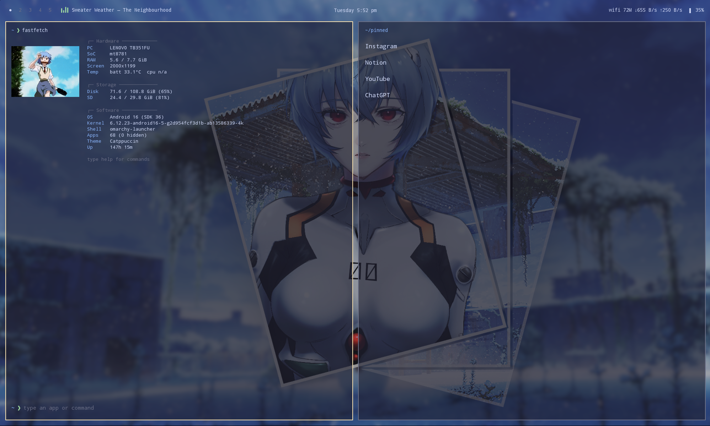
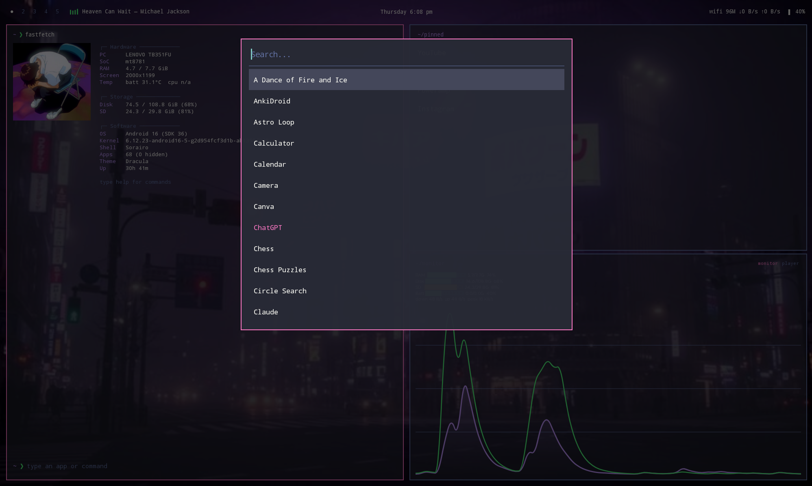
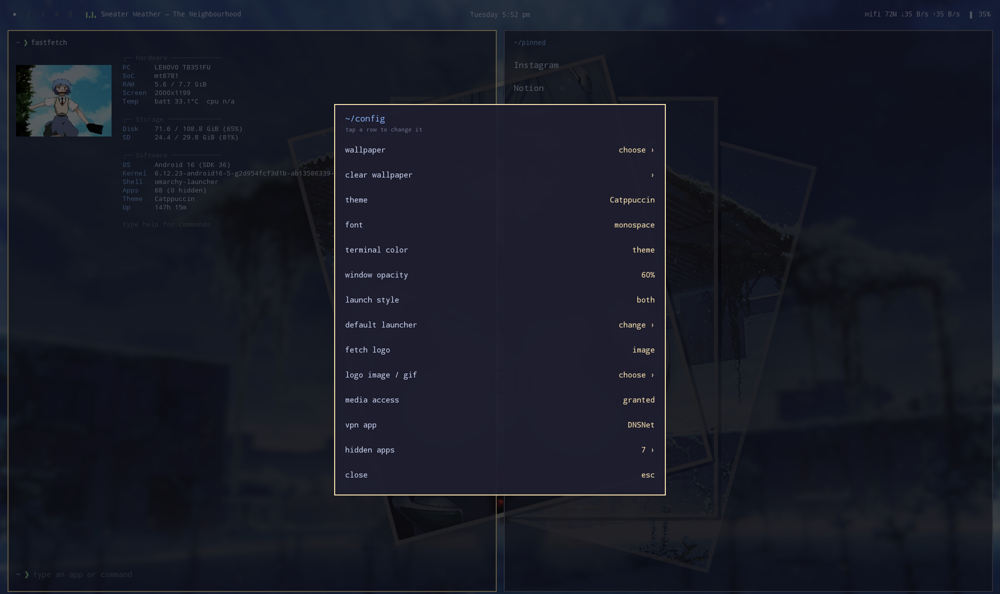
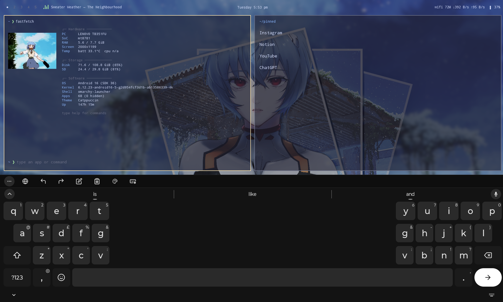

# Sorairo - Android launcher

A keyboard-first Android home screen inspired by Omarchy / Hyprland setups:
flat tiled "windows", a thin top bar, themes, and a type-to-launch terminal.

> Work in progress. Built for tablets (tested on a Lenovo tablet, Android 16).

## Screenshots

| Home screen | App drawer |
|---|---|
|  |  |

| Settings | Quick settings |
|---|---|
|  |  |

### Keyboard launch

## Features

- 5 workspaces: swipe sideways or tap the numbers on the top bar
- Fastfetch-style info window on every workspace, with a swappable logo
  (built-in ASCII logos, or your own image / GIF)
- Swipe up for a text-only app drawer with fuzzy search and auto-launch
- Terminal prompt: type an app name or a command (`help` lists them)
- Pinned apps per workspace (plain text list)
- Hide apps from the launcher
- Themes (Tokyo Night, Catppuccin, Gruvbox, Nord, Dracula), fonts,
  terminal colors, window opacity, custom wallpaper
- Top bar: clock, Wi-Fi speed, headphones, battery, now-playing with a
  small animated visualizer
- Long-press the battery area for a quick panel: Wi-Fi, Bluetooth, silent,
  airplane, battery saver, mic, camera, VPN, plus vertical volume and
  brightness sliders

## Things Android does not allow

Third-party apps cannot flip Wi-Fi, Bluetooth, airplane mode, battery saver
or the mic/camera privacy switches directly. Those tiles show the current
state and open the matching system screen. The VPN tile opens the VPN app
you pick; the launcher is not a VPN itself.
The visualizer next to the song name is decorative, not real audio analysis.

## Permissions

| Permission | Why |
| --- | --- |
| Notification access | read the currently playing song (optional) |
| Modify system settings | brightness slider (optional) |
| Do Not Disturb access | silent toggle (optional) |
| Network / Wi-Fi state | connection type and link speed |

Each one is requested only when you use the matching feature.

## Build

**Android Studio:** open the folder, let Gradle sync, press Run.

**Download the APK:** visit the
[Releases page](https://github.com/snorlaxmeow/omarchy-launcher/releases)
and download the APK attached to the latest release. If no release is
available yet, check the repository's Actions tab for a development build.

**Build with GitHub Actions (no PC needed):** push to GitHub; the workflow
in `.github/workflows/build.yml` builds a debug APK.

After installing, press Home and choose Sorairo as your default
launcher if you want to use it as your home screen.

## License

MIT
