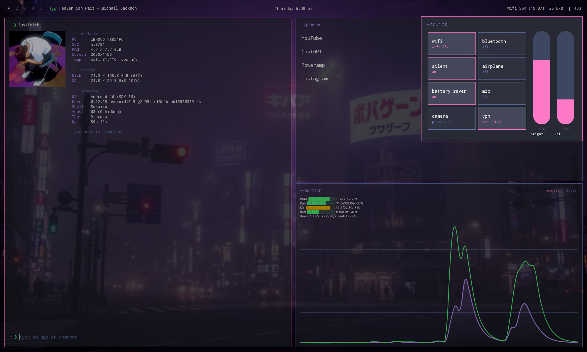

# Sorairo — Android launcher

Sorairo is a keyboard-first Android home-screen launcher inspired by Omarchy and Linux tiling-desktop workflows. It brings a terminal-like prompt, multiple workspaces, pinned apps, a system monitor, and a compact music player to Android tablets.

> Work in progress. Tested on a Lenovo tablet running Android 16.

## Screenshots

| Home workspace | App drawer and search |
|---|---|
|  |  |

| Quick settings | Keyboard launch |
|---|---|
|  |  |

| Settings |
|---|
|  |

## Features

- **Five workspaces:** move between workspaces by swiping or tapping the numbers in the top bar.
- **Type-to-launch:** type an app name into the terminal-style prompt to launch it, or use a command (the help command lists available commands).
- **App drawer:** text-first app list with fuzzy search and automatic launch.
- **Pinned and hidden apps:** keep frequently used apps close and hide apps you don't want in the launcher.
- **Fastfetch-style system panel:** hardware and software information, with built-in ASCII logos or a custom image/GIF.
- **System monitor:** RAM, internal storage, SD storage, battery, and network activity graph.
- **Music player:** compact playback controls and now-playing information.
- **Appearance controls:** themes (Tokyo Night, Catppuccin, Gruvbox, Nord, and Dracula), fonts, terminal colors, window opacity, and custom wallpaper.
- **Top bar:** clock, Wi-Fi link speed, headphones, battery, now-playing information, and a small animated visualizer.
- **Quick settings panel:** status tiles for Wi-Fi, Bluetooth, silent mode, airplane mode, battery saver, mic, camera, and VPN, plus brightness and volume sliders.

## Android limitations

Android does not let ordinary third-party apps directly toggle every system setting. Some quick-settings tiles show the current state and open the corresponding Android settings screen instead. The VPN tile opens the VPN app you choose; Sorairo is not itself a VPN.

The visualizer beside the song name is decorative and does not perform real audio analysis. Available system information and controls can vary by Android version and device.

## Permissions

| Permission | Why it is used |
|---|---|
| Notification access | Read currently playing media information (optional) |
| Modify system settings | Brightness slider (optional) |
| Do Not Disturb access | Silent-mode control (optional) |
| Network and Wi-Fi state | Show connection type and link speed |

Permissions are requested when you use the matching feature.

## Install

Download the APK from the [Sorairo Releases page](https://github.com/snorlaxmeow/Sorairo/releases). For development builds, open the [GitHub Actions page](https://github.com/snorlaxmeow/Sorairo/actions), select a successful **Build APK** run, and download the **Sorairo-apk** artifact.

After installing, press Home and choose **Sorairo** if you want to use it as your default launcher.

## Build

Open the repository in Android Studio, allow Gradle to sync, and run the app. The GitHub Actions workflow also builds a debug APK using the Gradle assembleDebug task.

## Credits

- **Olauncher:** inspiration for the minimal, text-first launcher experience and the interaction where typing an app's name launches it directly. Sorairo is an independent project and is not affiliated with Olauncher.
- **Omarchy / Linux tiling-desktop workflows:** inspiration for the workspace-oriented layout and terminal-like presentation.

## License

MIT
